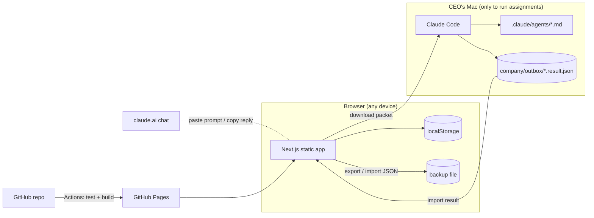

# Architecture

## Constraints that shaped it

| Constraint | Consequence |
|---|---|
| $0 additional budget | GitHub Pages (free for public repos), no paid database, no AI API |
| Claude Pro is interactive, not an API | AI work runs in the CEO's own Claude Code / claude.ai sessions; the dashboard prepares the input and records the output |
| Must work when the Mac is off | Static site on GitHub Pages; nothing depends on the local machine except running new assignments in Claude Code |
| Honesty about AI activity | Employees are profiles; execution state comes only from records the CEO created or imported |

## Components

- **Static export.** `next build` with `output: "export"` and `trailingSlash: true`
  writes one `index.html` per route, so a hard refresh works on GitHub Pages.
  Runtime-created records use query strings (`/tasks/view/?id=TSK-0001`).
- **Domain layer** (`src/lib/domain.ts`). Pure functions take the state and a
  context (actor, role, time) and return new state. They enforce permissions,
  status transitions, dependency rules, and CEO approval gates, and append an
  audit entry. Covered by `tests/unit/domain.test.ts`.
- **Store** (`src/lib/store.tsx`). Holds the state, persists to localStorage,
  syncs across tabs, validates on load (corrupt data is kept aside, never
  silently discarded), and keeps a one-step backup before imports/resets.
- **Execution bridge** (`src/lib/execution/`). `buildPacket()` assembles the
  employee's instructions, project/task context, approved upstream outputs
  (handoffs), and company rules. The result contract is a Zod schema; the JSON
  Schema in `docs/execution-result.schema.json` is generated from it.

## Workflow enforcement

- Task transitions are whitelisted (`TASK_TRANSITIONS`). Starting work requires
  an assignee and completed dependencies.
- A task with a `protectedAction` can't complete without an approved approval of
  that action. Moving it to *Awaiting CEO approval* files the request.
- A project reaches *Awaiting CEO approval* only through a release request, and
  only the CEO's decision moves it on. *Delivered* requires an approved release.
- Completing a task promotes its dependents from *Backlog* to *Assigned* when all
  their inputs are complete.
- Approving an output completes its task (or routes it to CEO approval when
  protected). Requesting changes sends the task back and counts a review round.

## Security model — read this

- With cloud sync, data is protected by Supabase Auth (emailed sign-in link) and
  Row Level Security: each account can only read/write its own row. The app
  ships only the public URL and publishable key. Turn off public sign-ups after
  the CEO's first sign-in.
- Roles (CEO / Operator / Viewer) are still a UI safeguard against mistakes, not a
  security boundary — anyone signed in as the CEO's account is the CEO.
- The public site serves only the seed data in this repository to visitors who
  aren't signed in.
- Imported files are schema-validated; Markdown is rendered to React elements
  (no raw HTML), links are restricted to http(s)/mailto/relative.
- CI refuses to publish a build containing strings that look like secrets.
- Production deploys go through the `github-pages` environment; add the CEO as a
  required reviewer so GitHub enforces the approval gate.

## AI team channel

`supabase/migrations/0002_agent_channel.sql`. The CEO creates an agent key (only its SHA-256 hash is stored).
A Claude session with the key can call one function, `submit_agent_report`, which appends a report to the CEO's
inbox (1 MB max, 120/hour). It cannot read or modify anything. The signed-in dashboard claims new reports
atomically (`claim_agent_reports`, so two devices never apply the same report), validates them
(`report-schema.ts`), and applies them through the domain layer with an **operator** role
(`apply-report.ts`): the team can create and progress work but cannot decide approvals, delete data, change
settings, or complete protected tasks. Outcomes are written back to the inbox, where the CEO can re-apply a report.

## Cloud sync (ADR-002)

`src/lib/cloud/` mirrors the state to Supabase (free tier: 500 MB DB, pauses after
1 week idle). localStorage stays the working copy, so the app works offline.

- `supabase/migrations/0001_company_state.sql`: one row per user, RLS, and
  `save_company_state(state, base_revision)` — an atomic compare-and-set.
- `reconcile.ts` (pure, unit-tested) decides push / pull / conflict from the
  device's last-seen revision and whether it has unsent changes. Conflicts keep
  the cloud copy and save the device's copy as a restorable backup.
- Sync runs after each change (debounced), on tab focus, when coming back online,
  and every 60 s while visible. The Supabase client is loaded only when
  `NEXT_PUBLIC_SUPABASE_URL` and `NEXT_PUBLIC_SUPABASE_KEY` are set at build time.
