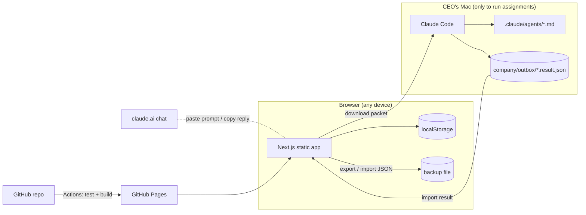

# Architecture

## Constraints that shaped it

| Constraint | Consequence |
|---|---|
| $0 additional budget | GitHub Pages (free for public repos), no paid database, no AI API |
| Claude Pro is interactive, not an API | AI work runs in the CEO's own Claude Code / claude.ai sessions; the dashboard prepares the input and records the output |
| Must work when the Mac is off | Static site on GitHub Pages; nothing depends on the local machine except running new assignments in Claude Code |
| Honesty about AI activity | Employees are profiles; execution state comes only from records the CEO created or imported |

## Components

- **Static export.** `next build` with `output: "export"` and `trailingSlash: true`
  writes one `index.html` per route, so a hard refresh works on GitHub Pages.
  Runtime-created records use query strings (`/tasks/view/?id=TSK-0001`).
- **Domain layer** (`src/lib/domain.ts`). Pure functions take the state and a
  context (actor, role, time) and return new state. They enforce permissions,
  status transitions, dependency rules, and CEO approval gates, and append an
  audit entry. Covered by `tests/unit/domain.test.ts`.
- **Store** (`src/lib/store.tsx`). Holds the state, persists to localStorage,
  syncs across tabs, and validates on load. Text that outgrew a limit is shortened
  (`parseOrRepairCompanyState`); otherwise unreadable data is kept aside, never
  silently discarded, and the sync record is reset so the next sync downloads the
  cloud copy instead of uploading the starting data over it. Every write is checked
  against the same schema before it is saved, so the app never stores something it
  could not load again. Edits to built-in records are kept in `state.edited`, and
  applied team reports in `state.appliedReports` — not in the (bounded) activity log.
- **Backups** (`src/lib/backups.ts`). Before an import, reset, restore, or a sync that
  replaces this device's data, the previous data is copied to IndexedDB (last 5,
  Settings → Data). If no backup can be stored, nothing is replaced.
- **Crash recovery** (`src/components/shell/error-boundary.tsx`, `src/app/global-error.tsx`).
  A rendering error shows a recovery screen with *Download my data* (the raw browser
  storage) instead of a blank page.
- **Execution bridge** (`src/lib/execution/`). `buildPacket()` assembles the
  employee's instructions, project/task context, approved upstream outputs
  (handoffs), and company rules. The result contract is a Zod schema; the JSON
  Schema in `docs/execution-result.schema.json` is generated from it.

## Workflow enforcement

- Task transitions are whitelisted (`TASK_TRANSITIONS`). Starting work requires
  an assignee and completed dependencies.
- A task with a `protectedAction` can't complete without an approved approval of
  that action. Moving it to *Awaiting approval* files the request.
- A project reaches *Awaiting CEO approval* only through a release request, and
  only the CEO's decision moves it on. *Delivered* requires an approved release.
- Completing a task promotes its dependents from *Backlog* to *Assigned* when all
  their inputs are complete.
- Approving an output completes its task (or routes it to CEO approval when
  protected). Requesting changes sends the task back and counts a review round.

## Security model — read this

- With cloud sync, data is protected by Supabase Auth (emailed sign-in link) and
  Row Level Security: each account can only read/write its own row. The app
  ships only the public URL and publishable key. Turn off public sign-ups after
  the CEO's first sign-in.
- Roles (CEO / Operator / Viewer) are still a UI safeguard against mistakes, not a
  security boundary — anyone signed in as the CEO's account is the CEO.
- The public site serves only the seed data in this repository to visitors who
  aren't signed in.
- Imported files are schema-validated; Markdown is rendered to React elements
  (no raw HTML). Every link built from stored text goes through `src/lib/safe-url.ts`:
  http(s)/mailto, or a single-slash internal path (`//host` and `/\host` are refused).
- Production pages carry a Content Security Policy: scripts, styles and fonts from the
  site only, and network access only to the site and the Supabase project.
- Sign-in uses PKCE: tokens never appear in the URL, and an emailed link works only in
  the browser that asked for it. GitHub sign-in is the main way in; sign-ups are off.
- CI refuses to publish a build containing strings that look like secrets.
- CI builds once with the production configuration, runs every E2E test against that
  build (Supabase stubbed, Chromium + WebKit), scans it for secrets, and deploys that
  same build. Deploys of this dashboard go through the `github-pages` environment with
  the CEO as required reviewer. (Client-project releases in `agency-projects` are the
  COO's decision — see KB-020.)

## AI team channel

`supabase/migrations/0002_agent_channel.sql`. The CEO creates an agent key (only its SHA-256 hash is stored).
A Claude session with the key (in the body, or as the `X-Aicos-Agent-Key` header added by a Claude Code on the web network secret, so the key never enters the cloud VM) can call one function, `submit_agent_report`, which appends a report to the CEO's
inbox (`0005_hardening.sql`: 256 KB max, 60 or 5 MB per hour, 200 waiting at most, reportId rules). It cannot
read anything; what it delivers does change the company once applied, so keep it secret. The signed-in dashboard
claims new reports atomically and in batches (`claim_agent_reports(p_limit)`; abandoned claims return after 10
minutes by the server's clock), validates them
(`report-schema.ts`), and applies them through the domain layer with an **operator** role
(`apply-report.ts`): the team can create and progress work but cannot decide approvals, delete data, change
settings, or complete protected tasks. A report's outcome is saved **in the same transaction as the company state
that contains its changes** (`save_company_state(state, base, outcomes)`): if that save is lost to a conflict, the
report stays unprocessed and is applied again. The CEO can re-apply partial or rejected reports from the inbox.
The company row itself can only change through `save_company_state` (a trigger refuses direct writes).

## Cloud sync (ADR-002)

`src/lib/cloud/` mirrors the state to Supabase (free tier: 500 MB DB, pauses after
1 week idle). localStorage stays the working copy, so the app keeps working when the
connection drops and uploads when it's back (opening it for the first time, or a
reload while offline, still needs the network — there is no service worker).

- `supabase/migrations/0001_company_state.sql`: one row per user, RLS, and
  `save_company_state(state, base_revision)` — an atomic compare-and-set.
- `reconcile.ts` (pure, unit-tested) decides push / pull / conflict from the
  device's last-seen revision and whether it has unsent changes. Conflicts keep
  the cloud copy and save the device's copy as a restorable backup.
- **Live updates** (`0006_realtime.sql`): a one-row-per-account `sync_signals` table changes whenever the
  company is saved or a team report arrives, and every open dashboard is subscribed to it over Supabase
  Realtime (free tier). Hearing it, the dashboard syncs within about a second; company data itself never
  travels through Realtime. Without 0006 (or offline), it falls back to checking every 20 s.
- Sync runs after each change (debounced), on tab focus, when coming back online, on every live
  signal, and on a timer as a safety net — in one tab at a time (`navigator.locks`). Nothing is
  uploaded while the browser refuses to save locally. The Supabase client is loaded only when
  `NEXT_PUBLIC_SUPABASE_URL` and `NEXT_PUBLIC_SUPABASE_KEY` are set at build time.
