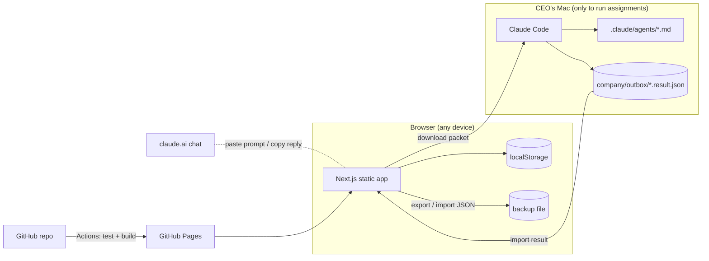

# Architecture

## Constraints that shaped it

| Constraint | Consequence |
|---|---|
| $0 additional budget | GitHub Pages (free for public repos), no paid database, no AI API |
| Claude Pro is interactive, not an API | AI work runs in the CEO's own Claude Code / claude.ai sessions; the dashboard prepares the input and records the output |
| Must work when the Mac is off | Static site on GitHub Pages; nothing depends on the local machine except running new assignments in Claude Code |
| Honesty about AI activity | Employees are profiles; execution state comes only from records the CEO created or imported |

## Components

- **Static export.** `next build` with `output: "export"` and `trailingSlash: true`
  writes one `index.html` per route, so a hard refresh works on GitHub Pages.
  Runtime-created records use query strings (`/tasks/view/?id=TSK-0001`).
- **Domain layer** (`src/lib/domain.ts`). Pure functions take the state and a
  context (actor, role, time) and return new state. They enforce permissions,
  status transitions, dependency rules, and CEO approval gates, and append an
  audit entry. Covered by `tests/unit/domain.test.ts`.
- **Store** (`src/lib/store.tsx`). Holds the state, persists to localStorage,
  syncs across tabs, validates on load (corrupt data is kept aside, never
  silently discarded), and keeps a one-step backup before imports/resets.
- **Execution bridge** (`src/lib/execution/`). `buildPacket()` assembles the
  employee's instructions, project/task context, approved upstream outputs
  (handoffs), and company rules. The result contract is a Zod schema; the JSON
  Schema in `docs/execution-result.schema.json` is generated from it.

## Workflow enforcement

- Task transitions are whitelisted (`TASK_TRANSITIONS`). Starting work requires
  an assignee and completed dependencies.
- A task with a `protectedAction` can't complete without an approved approval of
  that action. Moving it to *Awaiting CEO approval* files the request.
- A project reaches *Awaiting CEO approval* only through a release request, and
  only the CEO's decision moves it on. *Delivered* requires an approved release.
- Completing a task promotes its dependents from *Backlog* to *Assigned* when all
  their inputs are complete.
- Approving an output completes its task (or routes it to CEO approval when
  protected). Requesting changes sends the task back and counts a review round.

## Security model — read this

- In local mode there is **no server**, so roles (CEO / Operator / Viewer) are a
  safeguard against mistakes, not a security boundary.
- The public site serves only the seed data in this repository. Edits live in the
  browser that made them. Don't store confidential client data in local mode.
- Imported files are schema-validated; Markdown is rendered to React elements
  (no raw HTML), links are restricted to http(s)/mailto/relative.
- CI refuses to publish a build containing strings that look like secrets.
- Production deploys go through the `github-pages` environment; add the CEO as a
  required reviewer so GitHub enforces the approval gate.

## Upgrade path: shared, multi-device data (optional, $0)

Supabase's free tier can provide Postgres, auth (magic link), and Row Level
Security. Not enabled — it requires the CEO to create an account, and free
projects pause after about a week without activity (check current limits on
supabase.com/pricing before relying on it). Tracked as task TSK-0009.

Plan when approved:
1. One table `company_state (owner uuid primary key references auth.users,
   state jsonb not null, revision int not null, updated_at timestamptz)` with RLS
   `using (owner = auth.uid()) with check (owner = auth.uid())`.
2. Only the public anon key in the browser; never the service-role key.
3. Replace `load()` / `persist()` in `store.tsx` with an adapter that reads and
   upserts that row, using `revision` for conflict detection. Pages don't change.
